# Tabla de pruebas

**Commit evaluado:** `[hash]`  |  **Fecha:** [17/11/2026]  |  **JDK:** [25.0.4.1]

| # | Escenario | Resultado esperado | Resultado obtenido | Estado |
|---|-----------|--------------------|--------------------|--------|
| 1 | C1 con 20 registros | E001, E002, …, E020 | [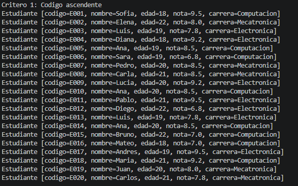] | no errores |
| 2 | C2 con 20 registros | Inicia con E005, E010, E014, E017 | [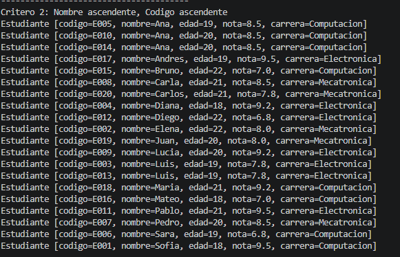] | no errores|
| 3 | C3: estudiantes con nota 8.5 | E014, E007, E005, E008, E010 | [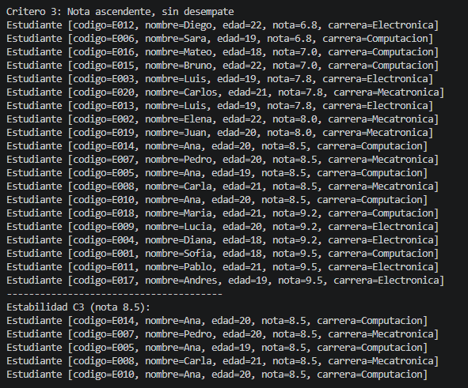] |no errores |
| 4 | C4 con 20 registros | Inicia con E017, E011, E001 | [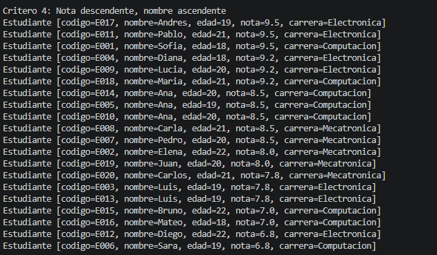] |no errores |
| 5 | C5 con 20 registros | Inicia con E001, E016, E004 | [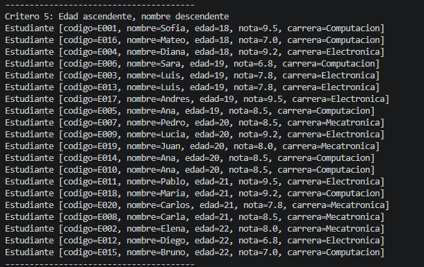] |no errores |
| 6 | C6 con 20 registros | Inicia con E001, E018, E005, E010, E014 | [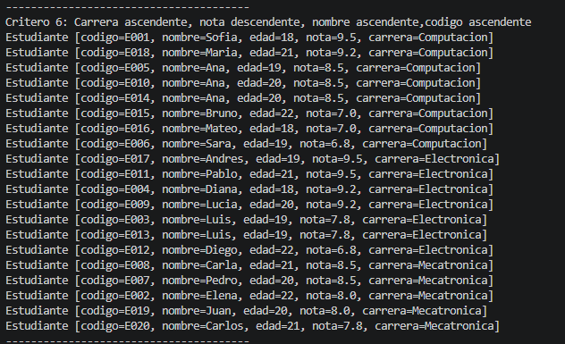] |no errores |
| 7 | C7: E001 y E018 | E001 = 10.0 (1.º), E018 = 9.7 (2.º); originales 9.5 y 9.2 | [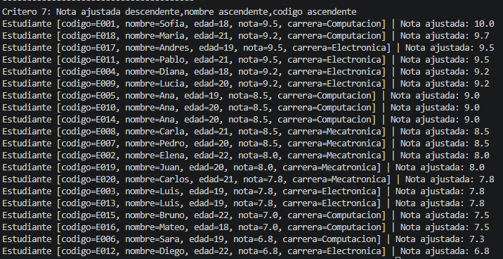] |no errores |
| 8 | Lista vacía | Sin errores, sigue vacía | [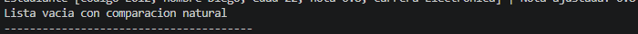] |no errores |
| 9 | Lista de un elemento | Sin errores, mismo contenido | [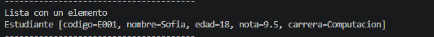] |no errores |
| 10 | C4 sobre E014, E005, E010 | E014, E005, E010 (empate total) | [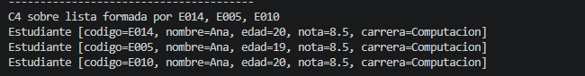]|no errores |
| 11 | Original tras todas las consultas | 20 códigos en el orden inicial | [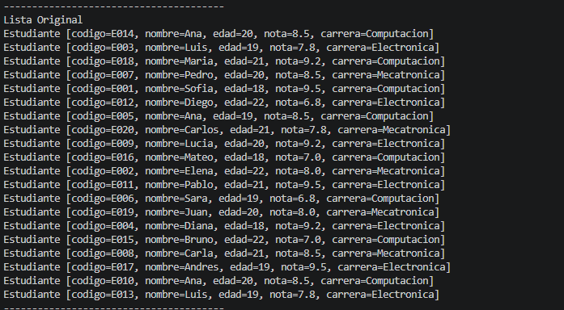] |no errores |
| 12 | Conservación de registros (C1–C7) | 20 códigos, sin pérdidas ni duplicados | [] |no errores |
