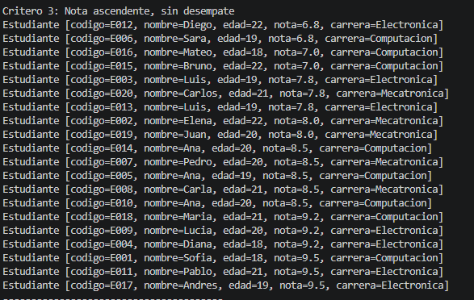
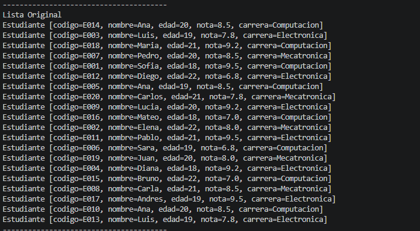

# PL2.1 – Ordenamiento de estudiantes con Comparator y Comparable

## Datos generales
- **Autor:** David Baroja
- **Carrera / Asignatura:** Computación / Estructura de Datos
- **Universidad:** Universidad Politécnica Salesiana
- **Práctica:** PL2.1 Comparator y Comparable
- **Versión del JDK:** OpenJDK 25.0.4.1 LTS (Microsoft Build)

## Objetivo
-

## Estructura del proyecto
icc-est-u1-prac1-or.../              
├── .vscode/
├── bin/                        
├── evidencias/                
│   ├── assets/                 (capturas de pantalla)
│   ├── Criterio_1.md
│   ├── Criterio_2.md
│   ├── Criterio_3.md
│   ├── Criterio_4.md
│   ├── Criterio_5.md
│   ├── Criterio_6.md
│   ├── Criterio_7.md
│   ├── Tabla_de_Pruebas.md        
└── src/
    ├── modelos/
        |──uso_Record/
    │   └── Estudiante.java
    ├── App.java
    ├── Comparators.java
    L── README.md

### Desde el IDE
1. [Visual Studio] → abrir la carpeta del proyecto.
2. Marcar `src/` como carpeta de fuentes.
3. Ejecutar `App.java` 

## Consultas implementadas

| ID | Orden requerido | Criterios (izquierda → derecha) | Método que lo implementa |
|----|-----------------|---------------------------------|--------------------------|
| C1 | Código ascendente | código ↑ | `Estudiante.compareTo()` |
| C2 | Nombre ↑; código ↑ | nombre ↑, código ↑ | `Comparadores.c2Lambda()` / `c2Comparing()` |
| C3 | Nota ↑ | nota ↑ | `Comparadores.c3()` |
| C4 | Nota ↓; nombre ↑ | nota ↓, nombre ↑ | `Comparadores.c4()` |
| C5 | Edad ↑; nombre ↓ | edad ↑, nombre ↓ | `Comparadores.c5()` |
| C6 | Carrera ↑; nota ↓; nombre ↑; código ↑ | 4 criterios | `Comparadores.c6()` |
| C7 | Nota ajustada ↓; nombre ↑; código ↑ | nota ajustada ↓, nombre ↑, código ↑ | `Comparadores.c7()` |

## Análisis
### Orden natural y signo de compareTo()
- Uso de orden natural con interfaz Comparable para la clase Estudiante.
- Cada metodo implemento interfaz Comparator que compara dos datos [compare()] o dos objetos [compareTo()] y retorna un tipo de dato primitivo int, cuyos valores pueden ser -1, 0 , 1; a < b , a = b , a > b

### Inversión de comparadores compuestos
- Al implementar .reversed() al final de los criterios de comparacion, el valor obtenido de Comaprator es multiplicado por -1, invirtiendo el orden del ordenamiento.

### Por qué comparar por nota puede dar cero con códigos distintos
- Porque el comparador creado solo evalua las notas entre los estudiantes y no sus codigos. Mismas notas, a = b no existe un cambio.

## Resultados obtenidos
| Consulta | Secuencia completa de códigos |
|----------|-------------------------------|
| C1 | [Odenamiento  por orden natural, codigo ascendente] |
| C2 | [Ordenamiento por Nombre ascendente, Codigo ascendente] |
| C3 | [Ordenamiento por Nota ascendente, sin desempate] |
| C4 | [Ordenamiento por Nota descendente, nombre ascendente] |
| C5 | [Ordenamiento por Edad ascendente, nombre descendente] |
| C6 | [Ordenamiento por Carrera ascendente, nota descendente, nombre ascendente,codigo ascendente] |
| C7 | [Ordenamiento por Nota ajustada descendente,nombre ascendente,codigo ascendente] |

## Pruebas
Ver [Evidencias/assets](evidencias/Tabla_de_Pruebas.md).

## Conclusiones 
1. Tanto Comparable como Comparator son interfaces dentro del lenguaje de Java. Comparable<T> define el orden natural de los objetos de una clase. ES por eso que es implementada por dicha clase mediante 'implements'. Y utiliza el metodo compareTo(), debido a que compara objetos a,b.
Por otro lado, Comparator<T> define uno o incluso varios criterios de ordenamiento y puede existir fuera de la clase  la que se quiere comparar sus atributos, en una expresion lambda o en metodos propios.Y utiliza el metodo de compare(T a, T b)
2. Sabemos que cuando dos o mas elementos son considerados iguales a = b dentro del criterio principal de ordenamiento, se agrega un segundo criterio para 'desempatar'. De esta manera se puede ordenar a los datos empatados dentro del dicho criterio secundario.
3. Sabemos que la estabilida juega un papel dentro del ordenamiento de listas, arreglos,etc. Y cuando ningun criterio existente logra desempatar a dos o mas elementos, el algoritmo dentro de Comparable y Comparator al ser de ordenamiento estable conservan el orden relativo original que traian previamente en la lista como en el C3  [][]

